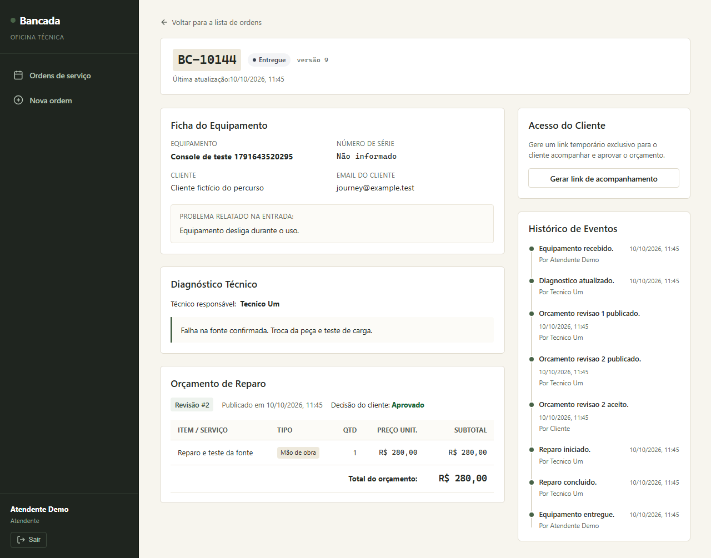
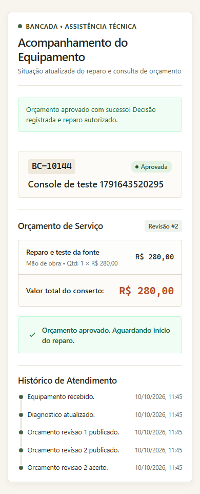

# Bancada

Operação de assistência técnica: recebimento, diagnóstico, orçamento, aprovação do cliente, reparo e entrega.

Projeto de portfólio de Diogo Pereira. Os atendimentos são fictícios. O fluxo completo está implementado e foi verificado localmente. A demonstração pública está em preparação.



## O problema

Autorizar um reparo exige saber qual orçamento o cliente aprovou. Uma alteração de preço não pode herdar a aprovação anterior, e duas abas não podem sobrescrever o diagnóstico uma da outra.

Bancada registra o trabalho do atendente, do técnico atribuído e do cliente. Cada mudança de estado tem ator e horário. Orçamentos publicados são revisões imutáveis; a API recusa a decisão sobre uma revisão superada. Repetir a mesma decisão não duplica eventos.

## Percurso

1. O atendente recebe o equipamento e atribui um técnico.
2. O técnico diagnostica e publica o orçamento.
3. O atendente gera o acesso limitado àquela ordem.
4. O cliente aprova ou rejeita pelo celular.
5. Após aprovação, o técnico inicia e conclui o reparo.
6. O atendente registra a entrega. A ordem permanece consultável com seu histórico.

Busca, filtros, paginação, cancelamento com motivo e recuperação de conflito de versão fazem parte do produto.



## Stack

Angular 21, TypeScript 5.9, ASP.NET Core/.NET 10, EF Core/Npgsql e PostgreSQL 17. Interface em português brasileiro; backend responsável por autorização, cálculo monetário e transições. Testes com xUnit, Vitest, Playwright e axe.

| Decisão | Consequência no produto |
| --- | --- |
| Identity, cookies HttpOnly e CSRF | Sessão da equipe e proteção nas escritas. |
| Autorização no servidor | Apenas o técnico atribuído diagnostica e executa o reparo. |
| Transação PostgreSQL e versão | Mudança e evento gravados juntos; uma aba antiga recebe 409. |
| Orçamento imutável por revisão | Um preço novo exige aprovação nova. |
| Preços decimais, total calculado pela API | Precisão excessiva é recusada, sem arredondamento silencioso. |
| Token aleatório, hash e cookie do cliente | Acesso restrito a uma ordem, com expiração e revogação. |

## Desenvolvimento local no Windows

Pré-requisitos: Node 24, npm, SDK .NET 10.0.401 e binários PostgreSQL 17. Nesta máquina o SDK está em `D:/Eu/Projetos/.tools/dotnet`; scripts detectam essa instalação local. Em outra máquina, use SDK no PATH ou configure DOTNET_ROOT.

Execute `./scripts/bootstrap.ps1` para preparar uma instância PostgreSQL isolada na porta 55417; não altera o serviço existente. Credenciais locais aleatórias e dados ficam em `.local/`, ignorado pelo Git. Instalação PostgreSQL em outro caminho aceita `-PostgresBin`.

Depois do bootstrap:

```powershell
npm ci
npm ci --prefix frontend
npx playwright install chromium
./scripts/seed.ps1
./scripts/dev.ps1
```

Interface: `http://localhost:4200`. API: `http://localhost:5080/health/ready`. As contas locais fictícias são `atendente@bancada.example`, `tecnico1@bancada.example` e `tecnico2@bancada.example`. A senha aleatória está no arquivo ignorado `.local/settings.json`. O seed é explícito e idempotente; o startup normal não executa migrations nem redefine dados.

Execute `./scripts/dev.ps1 -Stop` para encerrar os processos desta sessão antes de recompilar a API no Windows. Execute `./scripts/verify.ps1` para build e testes locais. Os testes de integração criam bancos PostgreSQL exclusivos; não são ignorados se o banco estiver indisponível. Playwright inicia API e Angular e percorre o atendimento sem interceptar a API.

Execução local de 10/10/2026: **65 testes backend, 36 frontend e 6 de navegador aprovados**, build backend sem avisos e build Angular válido. O percurso inclui três sessões separadas, persistência após recarregar, revisão superada, conflito entre abas e verificações automatizadas de acessibilidade e layout móvel. CI e hospedagem ainda aguardam execução.

## Documentação

- [Especificação](docs/superpowers/specs/2026-10-10-portfolio-design.md)
- [Plano](docs/superpowers/plans/2026-10-10-bancada.md)
- [Contrato HTTP](docs/contracts/http.md)
- [OpenAPI gerado](docs/contracts/openapi.json)
- [Arquitetura](docs/decisions/architecture.md)
- [Concorrência](docs/decisions/concurrency.md)
- [Evidência de execução](docs/evidence/progress.md)

Publicação planejada na Vercel com Neon Free. A demo oferece cinco atendimentos fictícios por visitante, alternância entre atendente e dois técnicos, reinício e limite de vinte ordens. Os dados são isolados por visitante e expiram em 24 horas. O isolamento, a troca de perfil entre abas e o reset foram verificados no navegador usando o pacote compilado de Angular e .NET; o funcionamento hospedado será verificado antes de anunciar a demonstração. Sem pagamentos reais, estoque, emissão fiscal, anexos ou envio de email/WhatsApp nesta versão.
